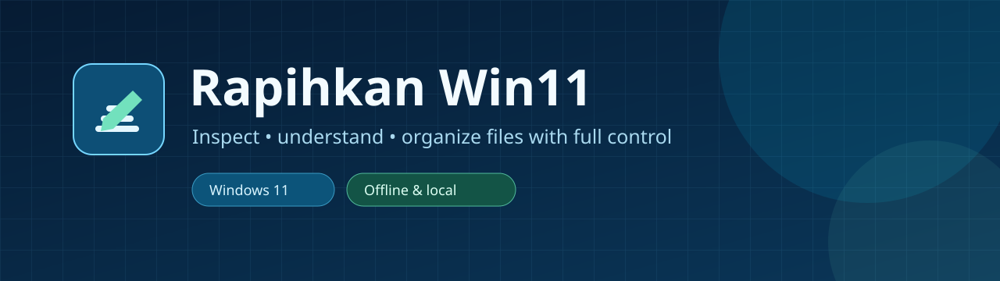

<p align="center">
  
</p>

<p align="center">
  <a href="LICENSE"></a>
  
  
  
</p>

<p align="center">
  A Windows 11 inspection and organization tool that shows the impact before moving files.
</p>

<p align="center">
  <a href="#get-started">Get started</a> ·
  <a href="#what-it-can-do">Features</a> ·
  <a href="#how-it-works">How it works</a> ·
  <a href="#safety-boundaries">Safety</a> ·
  <a href="CONTRIBUTING.md">Contributing</a>
</p>

> [!IMPORTANT]
> Rapihkan Win11 never permanently deletes files. When an action is available, you must type `YES` three times before it moves files.

## Get started

1. Copy the project folder to your computer.
2. Open PowerShell inside the folder.
3. Start the interactive launcher.

```powershell
& '.\Windows11-Maintenance-Standalone.ps1'
```

Choose a menu item, wait for the status to finish, then review the result. Scans of folders with many files can take longer.

## What it can do

| Icon | Menu item | What it does |
| :--: | --- | --- |
| 🔎 | Check your computer | Shows Windows, drive space, memory, and device information. |
| 📦 | Find large files | Finds files and folders using the most storage. |
| 🧹 | Find temporary files | Finds temporary-file candidates for Quarantine. |
| 🗂️ | Organize a folder | Builds a category plan for files in a selected folder. |
| 🧬 | Find duplicate files | Compares SHA-256 hashes to find identical copies. |
| 📈 | Check performance | Shows CPU, memory, and processes using the most memory. |
| 🩺 | Check Windows health | Checks pending restarts, Defender, and the firewall. |
| 📝 | Save a report | Creates local JSON, CSV, Markdown, or HTML reports. |

## How it works

```text
Choose a check
        ↓
Review results and recommendations
        ↓
Choose a safe action when available
        ↓
Type YES three times
        ↓
Files move or a report is saved
```

Checks do not change files. Actions are available only for temporary files that pass safety checks and approved folder-organization plans.

## When you choose an action

| Action | What happens | Can it be restored? |
| --- | --- | :---: |
| 🧹 Clean up temporary files | Safe files move to `Quarantine`. | Yes |
| 🗂️ Apply a folder plan | Files move to categories such as `Documents` or `Images`. | Review the destination first |
| 🧬 Duplicate files | The tool only shows comparison results. | No automatic action |
| ⚙️ Startup, cache, and drives | The tool only gives recommendations. | No automatic action |

> [!TIP]
> Type anything other than `YES` at any warning to cancel. Rapihkan Win11 does not move files until all three confirmations are complete.

## Safety boundaries

- Does not permanently delete files.
- Does not change the registry, services, startup apps, or drive settings.
- Does not restart your computer or send data to the internet.
- Skips system folders, reparse points, cloud files that are not stored locally, locked files, and existing destination names.
- Shows browser cache, work-app cache, duplicate files, startup apps, and drive optimization as recommendations. Decide what to do with those items yourself.

## Run a specific mode

Use these commands if you are comfortable with PowerShell.

```powershell
& '.\Windows11-Maintenance.ps1' -Mode Audit -ExportReport
& '.\Windows11-Maintenance.ps1' -Mode StorageAnalysis -Path 'C:\Users\Name'
& '.\Windows11-Maintenance.ps1' -Mode ApplySafeCleanup
& '.\Windows11-Maintenance.ps1' -Mode ApplyOrganize -Path 'C:\Users\Name\Downloads'
```

`ApplySafeCleanup` and `ApplyOrganize` still require three interactive confirmations.

## Where results are stored

| Folder | Contents |
| --- | --- |
| `Reports` | JSON, CSV, Markdown, and HTML reports. |
| `Logs` | Application activity records. |
| `Quarantine` | Moved temporary files and their restore manifests. |
| `Backup` | Backup manifests from related modules. |

These folders are excluded from Git because they can contain personal paths or file names.

## Contributing and license

Read the [contribution guide](CONTRIBUTING.md) before sending changes. This project uses the [MIT License](LICENSE).

## Test changes

Run every script below before opening a pull request.

```powershell
& '.\Tests\Toolkit-Tests.ps1'
& '.\Tests\Path-Validation-Tests.ps1'
& '.\Tests\Safety-Tests.ps1'
```
